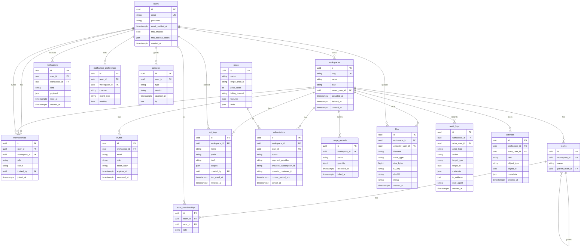

> **SaaS Template Playbook** › [Mục lục](../README.md) › Kiến trúc › Mô hình dữ liệu

# Data Model — Kernel Schema

Mô tả mô hình dữ liệu của **Kernel** (phần mọi SaaS đều có). Bảng Product (domain của bạn) cắm vào theo cùng convention — xem cuối tài liệu. Tham chiếu: [playbook §-map](../section-map.md) §6 (auth/api_keys), §7 (accounts), §9 (billing), §10 (database), §14 (notifications), §15 (files), §18 (audit).

## Convention chung

Mọi bảng tenant-scoped tuân thủ:

- `id` — **UUID v7** (sortable theo thời gian), không auto-increment.
- `workspace_id` — UUID **NOT NULL**, FK → `workspaces`. (Trừ bảng toàn cục: `users`, `workspaces`, `plans`, và `consents` — vì consent GDPR gắn với **con người**, không gắn tenant.)
- `created_at`, `updated_at` — timestamptz.
- `deleted_at` — timestamptz NULL nếu cần soft delete, kèm partial unique index `WHERE deleted_at IS NULL`.
- Bảng append-only (audit, billing event, webhook): **không** `updated_at`/`deleted_at`, không bao giờ UPDATE/DELETE, partition theo tháng.
- Actor đa hình: cặp `*_type` (`user`/`api_key`/`system`) + `*_id`.

---

## Sơ đồ ERD

> Sơ đồ lược `updated_at` cho gọn; mọi bảng **mutable** đều có `updated_at` theo Convention (bảng append-only như `audit_logs`/`activities` thì không). Một số FK phụ (vd `api_keys.created_by`) cũng được lược khỏi khối quan hệ.



---

## Mô tả bảng

### Identity & Tenancy

**`users`** — identity toàn cục (không tenant-scoped). Một user có thể thuộc nhiều workspace.
- `email` unique; `password` hash bằng `argon2id`. `mfa_backup_codes` hash, hiện một lần.

**`workspaces`** — tenant. Đơn vị isolation. `slug` unique (regex `[a-z0-9-]{3,40}`), dùng cho subdomain/path. `plan` denormalized để check nhanh; nguồn sự thật là `subscriptions`. `activated_at` = thời điểm activation event. Soft delete 30 ngày trước khi hard-delete.

**`memberships`** — nối user ↔ workspace kèm `role` (`owner`/`admin`/`member`/`viewer`) và `status` (`active`/`invited`/`suspended`). **Đây là bảng quyết định "user X thấy được workspace nào".** Unique: `UNIQUE (user_id, workspace_id)` (partial `WHERE deleted_at IS NULL` nếu soft delete) — chống trùng membership.

**`invites`** — lời mời. `token_hash` (không lưu token thô), `expires_at` 7 ngày. Khi accept → tạo `membership`. Nếu email đã có user → chỉ gắn membership.

**`teams`** / **`team_memberships`** — nhóm con trong workspace. `parent_team_id` cho cây team lồng nhau. `team_memberships` có `UNIQUE (team_id, user_id)`.

**`api_keys`** — key per-workspace cho integration. Chỉ lưu `prefix` (hiển thị) + `hash` (`sha256`). `scopes` JSON. Revoke bằng `revoked_at`.

### Billing

**`plans`** — định nghĩa gói. `price_cents` + `billing_interval` (`month`/`year`) — khớp với `price_cents` trong `config/product.php` (xem reskin-guide §3). `features` + `limits` để **JSON** (thêm gate không cần migration). `stripe_price_id` map sang Stripe Price.

**`subscriptions`** — provider-agnostic (ADR-0006). `status`: `trialing`/`active`/`past_due`/`canceled`. `payment_provider`: `stripe`/`paypal`/`manual`. Workspace gói free có thể **không** có dòng nào; theo thời gian có thể có nhiều dòng (canceled + mới). Ràng buộc "chỉ một active mỗi workspace" bằng partial unique: `UNIQUE (workspace_id) WHERE status IN ('trialing','active')`.

**`usage_records`** — đo usage cho billing theo lượng. `metric` (`ai.tokens`, `api.calls`…), `quantity`. Ghi từ worker (buffer từ Redis), không gọi Stripe đồng bộ.

### Notifications

**`notifications`** — inbox trong app (cũng là dạng bảng `notifications` của Laravel). `kind` + `payload` JSON. `read_at` NULL = chưa đọc.

**`notification_preferences`** — preference per user × channel × event_type. Mặc định event mới = enabled, cho opt-out một click. Mọi notification check bảng này trước khi gửi.

### Files

**`files`** — metadata file (byte nằm ở S3). `s3_key` prefix theo tenant: `{workspace_id}/{file_id}`. State machine: `pending` (chưa PUT xong) → `uploaded` (đã lên S3, chờ scan) → `scanned` (sạch, được serve) | `quarantined` (nhiễm). **Chỉ serve khi `scanned`** (mọi trạng thái trước đó đều từ chối serve).

### Audit, Activity, Compliance

**`audit_logs`** — **append-only, bất biến**, partition theo tháng. Log mọi action đặc quyền với `actor_type` đa hình. Khi user bị xóa (GDPR) → `actor_user_id = NULL`, giữ nguyên dòng. **Không có endpoint cho user sửa/xóa.**

**`activities`** — activity feed cho end-user ("Alice đổi tiêu đề"). Render theo template `{actor} {verb} {object}`. Khác audit log: có thể tóm tắt/dọn theo thời gian (retention 6 tháng). Actor ở đây luôn là **user** (feed cho người), nên dùng `actor_user_id`, không cần `actor_type` đa hình như `audit_logs`.

**`consents`** — log đồng ý GDPR. `type` + `version` + `granted_at` + `ip`. **Bảng toàn cục theo `user_id`, không có `workspace_id`** (consent gắn với con người, không gắn tenant). Cần từ ngày đầu để pass audit GDPR.

> **Feature flags** (Pennant) lưu ở bảng riêng `features` do package quản lý — schema thực tế là `features (name, scope, value)`, trong đó `scope` là chuỗi định danh đối tượng (`workspace:{id}`, `user:{id}`, hoặc null cho global). Không vẽ ở ERD trên vì do Pennant sở hữu.
>
> **Ngoài phạm vi ERD này (cố ý không vẽ):** các bảng vận hành do framework/queue quản lý hoặc tùy chọn — `cron_runs` (log scheduler, §12.4), bảng tiến độ job `status/progress_pct/total/current` (§12.5), `job_batches` (Laravel `Bus::batch`), và `outbox` nếu nâng lên outbox thật (§12.3). Chúng không thuộc kernel schema cốt lõi.

---

## RLS — pattern áp dụng cho mọi bảng tenant-scoped

```sql
ALTER TABLE issues ENABLE ROW LEVEL SECURITY;

CREATE POLICY issue_tenant_isolation ON issues
    USING (workspace_id = NULLIF(current_setting('app.workspace_id', true), '')::uuid);
```

Tenant middleware set GUC mỗi request: `DB::statement("SELECT set_config('app.workspace_id', ?, false)", [(string) tenant()->id])` — `SET` không nhận bound parameter nên dùng `set_config()`. `current_setting(..., true)` + `NULLIF` để query ngoài middleware (job/worker/migration) không vỡ runtime mà fail-closed (0 dòng). Đây là lớp 2 sau global scope của `BelongsToTenant`.

## Index trả tiền thuê

- Mọi foreign key.
- `(workspace_id, status, created_at DESC)` cho query "list X cho tenant".
- `pg_trgm` GIN trên cột search; `tsvector` GIN cho FTS.
- Partial unique cho soft delete: `... WHERE deleted_at IS NULL`.
- Unique chống trùng bảng nối: `memberships (user_id, workspace_id)`, `team_memberships (team_id, user_id)`.
- Một subscription active mỗi workspace: `UNIQUE (workspace_id) WHERE status IN ('trialing','active')`.
- `audit_logs`, `activities`: partition theo `created_at` (tháng) — phục vụ cả retention (DROP PARTITION cũ).

---

## Bảng Product cắm vào như thế nào

Bảng domain mới theo **đúng** convention trên — đây là điều giữ template nhất quán:

```php
// database/migrations/xxxx_create_tasks_table.php
Schema::create('tasks', function (Blueprint $table) {
    $table->uuid('id')->primary();                  // UUID v7
    $table->foreignUuid('workspace_id')             // bắt buộc, tenant scope
          ->constrained()->cascadeOnDelete();
    $table->foreignUuid('project_id')->constrained();
    $table->string('title');
    $table->string('status')->default('open');
    $table->uuid('created_by_id')->nullable();      // actor đa hình
    $table->string('created_by_type')->nullable();
    $table->softDeletes();
    $table->timestamps();

    $table->index(['workspace_id', 'status', 'created_at']);
});

// + RLS policy như pattern ở trên
```

Model dùng trait kernel: `use BelongsToTenant, HasUuids, SoftDeletes;` (Laravel 11+ `HasUuids` sinh UUID v7 mặc định). Chi tiết quy trình: [module-extension](../guides/module-extension.md).
